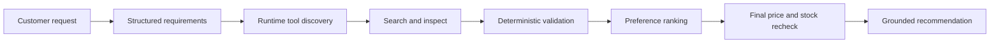

# AI Shopping Agent

[](https://www.python.org/)
[](evidence/evaluation-results.json)
[](evidence/evaluation-results.json)
[](docs/evaluation-report.md)
[](https://developers.openai.com/api/docs/guides/migrate-to-responses)

An auditable, schema-driven shopping agent that converts natural-language requests into verified product recommendations. It combines OpenAI-powered interpretation with deterministic validation so mandatory requirements, current price, and inventory can never be overridden by model judgment.

## Table of contents

- [Key features](#key-features)
- [How to understand the project](#how-to-understand-the-project)
- [How the agent works](#how-the-agent-works)
- [Technology stack](#technology-stack)
- [Prerequisites](#prerequisites)
- [Installation](#installation)
- [Configuration](#configuration)
- [Usage](#usage)
- [Testing and evaluation](#testing-and-evaluation)
- [Project structure](#project-structure)
- [Documentation](#documentation)
- [Known limitations](#known-limitations)
- [Contributing](#contributing)
- [Security](#security)

## Key features

- Separates mandatory constraints, preferences, and customer context.
- Uses the official OpenAI Python SDK and Responses API for structured extraction and function calling.
- Works without an API key through a deterministic schema-aware fallback.
- Discovers tool names, descriptions, and parameter schemas at runtime.
- Adapts to renamed parameters and nested request objects without fixed public tool signatures.
- Validates tool arguments locally before execution.
- Enforces price, RAM, storage, category, storage type, and availability in deterministic Python.
- Records request versions, candidates, rejected products, reasons, pending checks, tool attempts, errors, and model usage.
- Rechecks price and inventory immediately before recommending.
- Trips a per-run circuit breaker after an OpenAI connection failure and continues safely with one disclosed limitation.
- Produces grounded comparisons from verified tool results rather than untrusted model prose.
- Includes 35 catalog products, 52 documented scenarios, 83 offline tests, three live OpenAI tests, 88% branch-aware coverage, and five passing quality gates.

## How to understand the project

The design has four important rules:

1. **The model interprets; Python decides.** OpenAI may extract requirements and select a tool, but it cannot waive a mandatory constraint or declare unknown inventory available.
2. **Tools are discovered at runtime.** The agent receives the current function name, description, and JSON Schema. An unfamiliar function such as `inventory_lookup(product_code, region, requested_quantity)` can replace the original stock tool.
3. **Volatile facts are reverified.** Search results are not treated as final. Price, specifications, and inventory are retrieved again before a recommendation is returned.
4. **Failure is explicit and safe.** Missing required data triggers clarification, unknown availability fails closed, transient tool failures are bounded and logged, and OpenAI outages activate deterministic fallback.

### Mandatory constraints versus preferences

Mandatory constraints determine validity. A product that violates any one of them is rejected regardless of rating or price.

| Requirement type | Examples | Effect |
|---|---|---|
| Mandatory | Maximum price, minimum RAM, minimum storage, SSD, in stock | Failure rejects the product |
| Preference | Battery life, weight, rating, price headroom | Affects ranking only |
| Context | Software development | Helps interpret and explain the request |

### Execution modes

| CLI mode | Meaning |
|---|---|
| `openai` | OpenAI structured extraction and tool selection completed successfully |
| `openai configured; deterministic fallback active` | A key is configured, but the API was unreachable or a model step failed; safe local logic completed the run |
| `offline-schema-aware` | No API key is configured; the fully local deterministic implementation is active |

## How the agent works



1. Parse the request into typed `Requirements`.
2. Ask the configured model to select from the current runtime tool definitions.
3. Bind and validate arguments against the supplied JSON Schema.
4. Execute only through `ToolExecutor` and record every attempt.
5. Retrieve complete product details and reject missing or invalid mandatory data.
6. Verify inventory, retrieve reviews, and rank only valid products.
7. Re-fetch details and inventory in rank order until three current valid candidates survive.
8. Continue the Responses function-call loop with matching `call_id` results.
9. Render the recommendation, mandatory checks, score breakdown, alternatives, trade-offs, and limitations from verified evidence.

For deeper design details, see the [architecture](docs/architecture.md) and [architectural decisions](docs/decisions.md).

## Technology stack

| Technology | Purpose |
|---|---|
| Python 3.11+ | Application and evaluation runtime |
| OpenAI Python SDK 2.x | Responses API, structured extraction, and function calling |
| GPT-4o Mini | Default configurable live model |
| Pydantic 2.x | Strict requirements, product, state, and response models |
| JSON Schema | Runtime tool contracts and argument validation |
| python-dotenv | Local environment configuration |
| pytest | Automated unit, workflow, resilience, and live tests |
| pytest-cov / coverage.py | Branch-aware coverage enforcement |
| JSON / JSONL | Mock catalog, inventory, reviews, tool manifest, and audit logs |
| Git | Version control and reviewable implementation history |

No agent framework such as LangChain, AutoGen, or the OpenAI Agents SDK is required. The orchestration is intentionally implemented with the official OpenAI SDK and normal Python components so state transitions and tool behavior remain visible and testable.

## Prerequisites

- Python 3.11 or newer
- `pip` and Python virtual-environment support
- Git, if cloning the repository
- PowerShell 7+, Windows PowerShell 5.1, Bash, or another standard terminal
- An OpenAI API key only for live model mode and live integration tests
- Internet connectivity only for dependency installation and OpenAI mode

No database, container runtime, GPU, or external product service is required. The catalog and mock tools run locally.

## Installation

### 1. Clone the repository

Replace `<repository-url>` with the repository URL supplied by the project owner:

```bash
git clone <repository-url>
cd michael
```

If the project is already available locally, open a terminal in its root directory and continue below.

### 2. Create and activate a virtual environment

PowerShell:

```powershell
python -m venv .venv
.venv\Scripts\Activate.ps1
```

macOS or Linux:

```bash
python3 -m venv .venv
source .venv/bin/activate
```

### 3. Install the project and development dependencies

```bash
python -m pip install --upgrade pip
python -m pip install -e ".[dev]"
```

### 4. Create the local environment file

PowerShell:

```powershell
Copy-Item .env.example .env
```

macOS or Linux:

```bash
cp .env.example .env
```

The project runs offline when `OPENAI_API_KEY` is blank. Add a key only when live OpenAI behavior is required.

### 5. Verify the installation

```bash
shopping-agent --help
python -m pytest -m "not live"
```

## Configuration

Configure the application in `.env`:

```env
OPENAI_API_KEY=
OPENAI_MODEL=gpt-4o-mini
OPENAI_TIMEOUT_SECONDS=30
OPENAI_MAX_RETRIES=2
SHOPPING_AGENT_LOG_PATH=logs/agent.jsonl
```

| Variable | Required | Default | Description |
|---|---:|---|---|
| `OPENAI_API_KEY` | No | Empty | Enables live OpenAI mode when populated |
| `OPENAI_MODEL` | No | `gpt-4o-mini` | Model used for structured extraction and tool calling |
| `OPENAI_TIMEOUT_SECONDS` | No | `30` | Timeout for an OpenAI request |
| `OPENAI_MAX_RETRIES` | No | `2` | SDK retry limit for OpenAI requests |
| `SHOPPING_AGENT_LOG_PATH` | No | `logs/agent.jsonl` | Destination for append-only audit events |

Never commit `.env` or an API key.

## Usage

### Run the default assessment request

```powershell
shopping-agent
```

### Submit a custom request

PowerShell:

```powershell
shopping-agent 'I need a development laptop under $1,000 with 32GB RAM and 1TB SSD'
```

PowerShell expands `$...` expressions inside double-quoted strings. Use single quotes around requests containing dollar amounts, or escape the dollar sign:

```powershell
shopping-agent "I need a laptop under `$1,000 with 32GB RAM and 1TB SSD"
```

macOS or Linux:

```bash
shopping-agent 'I need a development laptop under $1,000 with 32GB RAM and 1TB SSD'
```

### Return the complete typed state as JSON

```powershell
shopping-agent --json
```

The JSON output includes parsed requirements, discovered tools, candidates, rejection reasons, pending checks, tool calls, errors, workflow phases, model metrics, and the final recommendation.

### Run without installing the package

PowerShell:

```powershell
$env:PYTHONPATH = "src"
python -m ai_shopping_agent
```

macOS or Linux:

```bash
PYTHONPATH=src python -m ai_shopping_agent
```

### Interpret the result

A successful response contains:

- the selected product and current price;
- explicit mandatory-constraint checks;
- a normalized preference score from 0 to 100;
- up to two alternatives and their trade-offs;
- a comparison grounded in current tool output;
- limitations, including any deterministic fallback used during the run.

Runtime audit logs are written to `logs/agent.jsonl` by default. A committed example is available in [the sample run](evidence/sample-run.jsonl).

## Testing and evaluation

### Offline test suite

```bash
python -m pytest -m "not live"
```

### Branch-aware coverage gate

```bash
python -m pytest -m "not live" \
  --cov=ai_shopping_agent \
  --cov-branch \
  --cov-report=term \
  --cov-fail-under=85
```

For PowerShell, enter the same command on one line.

### Five-gate evaluator

```bash
shopping-agent-eval
```

The evaluator requires:

- a non-empty passing offline test run;
- at least 85% branch-aware coverage;
- passing targeted tests for every quality gate;
- at least 30 catalog products and 30 documented scenarios;
- all required source, test, documentation, and evidence files.

It writes the machine-readable result to [evidence/evaluation-results.json](evidence/evaluation-results.json).

### Paid live OpenAI evaluation

```bash
shopping-agent-eval --live
```

This requires `OPENAI_API_KEY` and makes paid API calls. It validates live structured extraction, unfamiliar function calling, function-result continuation, the complete recommendation workflow, and follow-up budget preservation.

Current verified result: **83 offline tests passed, three live tests passed, 88% branch-aware coverage, and five of five quality gates passed.** See the [evaluation report](docs/evaluation-report.md) for the cycle history and failure analysis.

## Project structure

```text
.
|-- data/
|   |-- catalog.json             # 35 products, including adversarial records
|   |-- inventory.json           # Regional stock snapshots
|   |-- reviews.json             # Review summaries
|   `-- tool_manifest.json       # Runtime names, descriptions, and schemas
|-- docs/
|   |-- architecture.md
|   |-- decisions.md
|   |-- evaluation-report.md
|   |-- limitations.md
|   `-- live-defense-runbook.md
|-- evidence/
|   |-- evaluation-results.json
|   `-- sample-run.jsonl
|-- src/ai_shopping_agent/
|   |-- agent.py                 # Orchestration and recovery
|   |-- model_client.py          # Offline and OpenAI model adapters
|   |-- models.py                # Strict typed domain and state models
|   |-- parser.py                # Deterministic requirement parser
|   |-- validation.py            # Mandatory-constraint authority
|   |-- ranking.py               # Normalized preference ranking
|   |-- response.py              # Grounded response construction
|   |-- evaluation/              # Repeatable quality-gate evaluator
|   `-- tools/                   # Registry, schema adapter, and executors
|-- tests/
|   |-- cases/scenarios.json     # 52 documented expected outcomes
|   `-- test_*.py                # Unit, workflow, resilience, and live tests
|-- .env.example
|-- pyproject.toml
`-- README.md
```

## Documentation

- [Architecture](docs/architecture.md) - components, trust boundaries, state lifecycle, dynamic tools, and failure policy.
- [Architectural decisions](docs/decisions.md) - major choices and trade-offs.
- [Evaluation report](docs/evaluation-report.md) - test metrics, quality gates, failures, root causes, and fixes.
- [Known limitations](docs/limitations.md) - current boundaries and proposed improvements.
- [Live defense runbook](docs/live-defense-runbook.md) - commands and modifications to rehearse before a technical defense.
- [Assessment PDF](requirement/AI_Shopping_Agent_Technical_Assessment.pdf) - original technical requirements and evaluator scorecard.

## Known limitations

- The deterministic parser focuses on the assessment's English laptop requests; implicit or multilingual requests require live model mode.
- The local schema validator supports the assessment and common nested schemas, not every JSON Schema draft keyword.
- The supplied catalog contains one product category and one mock inventory region.
- Preference weights are documented engineering choices rather than learned from customer feedback.
- Live results depend on network access, API availability, account access, and the configured model.

See [docs/limitations.md](docs/limitations.md) for the improvement roadmap.

## Contributing

Contributions should preserve deterministic hard constraints and the existing evaluation evidence.

1. Search existing issues before reporting a bug or proposing a feature.
2. Open an issue describing the current behavior, expected behavior, reproduction steps, and relevant logs with secrets removed.
3. Create a focused branch:

   ```bash
   git checkout -b fix/short-description
   ```

4. Add or update tests before changing behavior.
5. Run the offline suite and evaluator:

   ```bash
   python -m pytest -m "not live"
   shopping-agent-eval
   ```

6. Use a concise conventional commit message, for example:

   ```text
   fix: reject products with unknown inventory
   ```

7. Submit a pull request that explains the problem, implementation, test evidence, compatibility impact, and any documentation changes.

Pull requests should not weaken mandatory validation, lower the coverage threshold, bypass the tool layer, commit generated secrets, or remove an existing supported scenario without an explicit architectural decision.

## Security

- `.env`, API keys, and local logs are excluded from normal commits.
- Tool and decision logs do not contain the configured API key.
- OpenAI Responses requests use `store=False`.
- Tool-loop results are linked to their function calls with matching `call_id` values.
- Tool arguments are validated before execution.
- Unknown inventory fails closed.
- The local mock environment performs no external product or purchasing operations.

If a secret is accidentally exposed, revoke it immediately, remove it from Git history, and create a replacement. Do not include credentials or sensitive customer data in bug reports, logs, screenshots, or pull requests.
