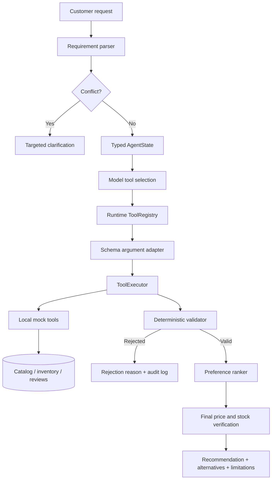

# Architecture

## Design

The project uses one agent with explicit components. A multi-agent design would add coordination cost without measurable value for this bounded workflow.



## Trust boundaries

The model may:

- extract structured customer intent;
- select among supplied tool definitions;
- bind arguments to the current schema;
- support the natural-language explanation.

The model may not:

- waive mandatory constraints;
- invent missing values;
- mark unknown stock as available;
- rank an invalid product;
- bypass the tool executor.

## State lifecycle

`AgentState` owns the authoritative run state:

```text
raw request + version
requirements
discovered tools
candidate identifiers
verified product snapshots
rejected products and reasons
pending checks
tool-call attempts
recoverable errors
final recommendation
```

A customer update increments the request version and invalidates candidates, product snapshots, rejections, errors, pending checks, and the recommendation. The run ID and historical tool-call audit remain stable across the conversation.

## Dynamic tools

`ToolRegistry` loads name, description, parameters, and a private local handler mapping. Only the public function definition is sent to the model. `ArgumentAdapter` uses parameter names and descriptions to map semantic values, so a runtime tool such as:

```text
inventory_lookup(product_code, region, requested_quantity)
```

can replace `check_availability(product_id)` without changing agent orchestration.

All calls are locally checked for required arguments, primitive types, arrays, enumerations, and unexpected properties before execution.

## Failure policy

| Failure | Policy |
|---|---|
| Transient tool error | Retry within the configured bound and log every attempt |
| Permanent search failure | Return an explicit error; do not fabricate candidates |
| Availability failure | Fail closed and exclude unverified products |
| Review failure | Continue with a disclosed limitation |
| Missing mandatory field | Reject the product |
| Model parsing/selection failure | Use deterministic fallback and disclose it |
| Price/stock change | Revalidate against the latest snapshot |

